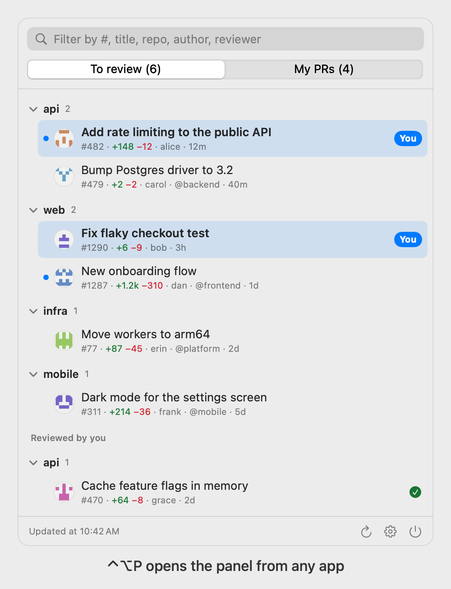

# PRty Time

A macOS menu-bar app that lists the GitHub pull requests waiting on you, and notifies you when something happens on them. A small replacement for [Trailer](https://github.com/ptsochantaris/trailer).

<picture>
  <source media="(prefers-color-scheme: dark)" srcset="docs/demo-dark.gif">
  
</picture>

## Features

- **To review:** PRs requesting your review (marked *You*) or your teams' review, newest first, then open PRs you've already reviewed. Team requests idle for 30+ days are hidden.
- **My PRs:** your open PRs with their review state (approved, changes requested, awaiting review).
- **Grouped by repo:** click a repo to collapse it; remembered across launches. To put repos in your own order, turn on *Drag repos into your own order* in Settings and drag a repo onto another; repos you haven't moved go below, newest activity first.
- **Right-click a PR** to open its checks, mark it read or unread (or everything in the tab read), snooze it, or copy its link, branch name or `gh pr checkout` command.
- **Snooze:** right-click a PR to hide it until there's new activity, tomorrow morning or next week. It waits, dimmed, in a *Snoozed* section at the bottom of its tab and leaves the badge. Anything that would give it a blue dot brings it back early, as do failing checks on your own PRs.
- **Filter:** type to filter by number (`#123`), title, repo, author or reviewer. Every word must match.
- **Keyboard:** ⌃⌥P opens the panel from any app with the filter ready to type in (change or turn off the shortcut in Settings). ↑ and ↓ pick a PR, ↩ opens it (while filtering, the first match without picking), ⌘1 and ⌘2 switch tabs, and Esc clears the filter, then closes.
- **Unread dots:** a blue dot marks new activity you haven't opened. It clears when you open the PR from the panel or its notification, mark it read (right-click), or read it on GitHub (synced through your GitHub notifications). Activity GitHub doesn't notify you about, such as pushes, only clears from PRty Time.
- **At a glance:** each row shows the author's avatar and the lines added and removed (the counts can be turned off in Settings).
- **Checks and conflicts** (turn off in Settings): every PR shows whether its checks passed, failed or are still running, as GitHub does next to the title, and a *Conflicts* tag when it can't merge cleanly.
- **Badge:** the menu-bar icon shows how many PRs await your review.
- **Updates:** checks GitHub once a day and tells you, once per version, when a new release is out, with the `brew` command or the download link (turn off in Settings).

### Notifications

- Reviews, approvals and comments on your PRs
- New review requests to you or your teams
- Comments, reviews and pushes on PRs you review
- Merges of your PRs and of PRs you review
- Failed checks on your PRs, with checks turned on

Your own actions are ignored, including your own merges unless auto-merge did them. *Ignore bots* (on by default) hides PRs opened by bots such as dependabot and mutes bot comments. Each kind can be turned off in Settings.

Notifications stack together in Notification Center, so one click clears them all. To get a stack per PR, set *Group notifications* to *By PR* in Settings; this needs macOS's notification grouping for PRty Time (System Settings → Notifications) left on *Automatic*.

## Requirements

- macOS 15 or later, Apple Silicon or Intel
- [GitHub CLI](https://cli.github.com), logged in with `gh auth login`. PRty Time reuses its token, so there's nothing else to configure.

## Install

With [Homebrew](https://brew.sh), which also installs the GitHub CLI:

```sh
brew install --cask fragkakis/tap/prty-time
```

Or download `PRty-Time.zip` from the [latest release](https://github.com/fragkakis/prty-time/releases/latest), unzip it, move `PRty Time.app` to `/Applications` and open it. Use `/Applications`, not `~/Applications`: macOS can't show notification icons for apps inside your home folder.

PRty Time isn't notarized by Apple, so macOS blocks the first launch with "Apple could not verify PRty Time…". Open System Settings → Privacy & Security and click **Open Anyway**, or run `xattr -dr com.apple.quarantine "/Applications/PRty Time.app"`. You only need to do this once per download.

### From source

Needs the Xcode Command Line Tools (`xcode-select --install`); full Xcode isn't needed. Apps you build yourself aren't blocked.

```sh
git clone https://github.com/fragkakis/prty-time.git
cd prty-time
make install   # builds, ad-hoc signs, copies to /Applications/PRty Time.app and launches it
```

### After installing

Allow notifications when macOS asks. To start PRty Time at login, turn on *Launch at login* in Settings (⌘, in the panel).

## Development

```sh
make test      # unit tests
make run       # build and launch from .build/ without installing
make logs      # stream poll logs (one line per poll: requests, cost, duration)
make icon      # redraw Resources/AppIcon.icns from Scripts/icon.swift
make zip       # universal (Apple Silicon + Intel) build, zipped to .build/PRty-Time.zip
```

**Releasing:** bump `CFBundleShortVersionString` and `CFBundleVersion` in `Resources/Info.plist`, then push a tag (`git tag v1.2.3 && git push origin v1.2.3`) or publish a release with a new `v*` tag on github.com. The Release workflow builds the zip on GitHub's macOS runners, attaches it to the release (adding the install notes from `.github/release-notes.md` when it creates the release), and updates the cask in [fragkakis/homebrew-tap](https://github.com/fragkakis/homebrew-tap) using the `TAP_DEPLOY_KEY` secret.

- **API usage:** one GraphQL request per poll (every 2 min by default), about 20 of the 5,000 points GitHub allows per hour, plus 1-point lookups for the line counts and branch names of new or updated PRs, and when a PR drops off your lists (to tell merged from closed). With checks turned on (the default), another 1-point lookup per poll for the PRs on show. While any dot is showing, one REST request to your GitHub notifications checks what you've read there. Once a day, one REST request looks for a newer release. Polling pauses when the rate limit runs low.
- **State:** `~/Library/Application Support/Prty/state.json` holds what was already seen, so restarts don't re-notify.
- **Debug:** `defaults write com.fragkakis.prty notifySelf -bool YES` counts your own comments as activity, so you can test notifications on your own PR.

## License

[MIT](LICENSE)
